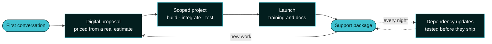

<!--
  This is the public profile README for github.com/linchpin. GitHub reads it from
  profile/README.md in the public linchpin/.github repository.

  House rules for editing it:
  - Don't name a client, quote a metric or claim an award unless the team has supplied it.
  - American English. The name is Linchpin and the domain is linchpin.com.
  - Link only to public repositories; a private one is a 404 to every visitor.
-->

<div align="center">

<a href="https://linchpin.com">
  <picture>
    <source media="(prefers-color-scheme: dark)" srcset="https://assets.linchpin.com/linchpin-logo-white.svg">
    <source media="(prefers-color-scheme: light)" srcset="https://assets.linchpin.com/linchpin-logo-primary.svg">
    
  </picture>
</a>

### A boutique WordPress agency that works as an extension of your team.

[](https://linchpin.com)
[](mailto:sayhi@linchpin.com)
[](https://x.com/linchpin_agency)
[](https://www.linkedin.com/company/linchpin/)

</div>

---

We build and care for WordPress for **higher education, nonprofits and B2B organizations**:
teams with stakeholders to answer to, accessibility written into their contracts, and a
budget smaller than the problem. We take on the complex integrations that would bog a larger
agency down, we train your team and document the work as we go, and then we stay.

~~A PDF with a number on it.~~ A proposal you can read online, priced from a real estimate.

> [!TIP]
> **Looking for a WordPress partner?** Start at [linchpin.com](https://linchpin.com) or
> email [sayhi@linchpin.com](mailto:sayhi@linchpin.com).

## :compass: What we do

| | |
| :--- | :--- |
| :building_construction: **Build** | Block themes, custom Gutenberg blocks and plugins on current WordPress, built to WCAG 2.2 AA[^a11y]. |
| :electric_plug: **Integrate** | Commerce, CRM, forms, project tools and the other systems your organization already runs on. |
| :handshake: **Care for** | Support packages whose hours, burn and period reports you see in your own client portal, plus nightly dependency updates that are tested before they ship. |
| :books: **Leave you capable** | Training and documentation are part of the deliverable, so your team can run what we built. |
| :hammer_and_wrench: **Make our own products** | Client work runs on plugins and tooling we maintain ourselves. Some of it is below. |

### From the first conversation to the long haul



### Support you can see

Hours are logged against your package and reported for each period in your portal. The pace
line on those reports is plain arithmetic, and we show our working:

$$
\text{planned pace per month} = \frac{\text{period budget}}{\text{months in the period}}
$$

Running above the line means the period is ahead of plan, not over budget.

## :package: Open source

> [!NOTE]
> Most client work lives in private repositories. What you'll find here is the tooling and
> the products we share. For the client work itself, see [linchpin.com](https://linchpin.com).

Press <kbd>.</kbd> on any repository below to browse it in GitHub's web editor, no clone needed.

| Project | What it does | |
| :--- | :--- | :---: |
| [**psst**](https://github.com/linchpin/psst) | One-time, expiring secrets for WordPress. Encrypted in the browser, so the server only ever holds ciphertext. Try it at [psst.linchpin.com](https://psst.linchpin.com). | [](https://github.com/linchpin/psst/releases) |
| [**skills**](https://github.com/linchpin/skills) | Our library of AI agent skills for WordPress, React and Cloudflare Workers projects. Works in Claude Code, GitHub Copilot, Codex and Cursor. | [](https://www.npmjs.com/package/@linchpinagency/skills) |
| [**cli**](https://github.com/linchpin/cli) | Git worktrees and local environment switching for WordPress (Studio, LocalWP, wp-env), with commands an agent can run. | [](https://www.npmjs.com/package/@linchpinagency/cli) |
| [**ui**](https://github.com/linchpin/ui) | The admin chrome every Linchpin plugin shares, built on `@wordpress/admin-ui`. | [](https://www.npmjs.com/package/@linchpinagency/ui) |
| [**docspress**](https://github.com/linchpin/docspress) | Our fork of DocsPress. Markdown docs from many repositories, published to one WordPress site and synced back as pull requests. | [](https://github.com/linchpin/docspress/releases) |
| [**actions**](https://github.com/linchpin/actions) | Reusable GitHub workflows that build, deploy and maintain WordPress sites, plus our Renovate presets. |  |
| [**coding-standards**](https://github.com/linchpin/coding-standards) | PHPCS rules layered on the WordPress and VIP standards. | [](https://packagist.org/packages/linchpin/coding-standards) |
| [**commitlint-config**](https://github.com/linchpin/commitlint-config) | The commit convention every Linchpin repository follows. | [](https://www.npmjs.com/package/@linchpinagency/commitlint-config) |

### :jigsaw: On WordPress.org

| Plugin | | |
| :--- | :--- | :---: |
| [Toggle wpautop](https://wordpress.org/plugins/toggle-wpautop/) | Turn off WordPress's automatic paragraphs one post at a time. Active on  sites.[^installs] |  |
| [Courier Notices](https://wordpress.org/plugins/courier-notices/) | Site-wide notices and alerts, managed from the admin. |  |
| [Post Type Spotlight](https://wordpress.org/plugins/post-type-spotlight/) | A "featured" checkbox for any post type, queryable as a taxonomy. |  |

<details>
<summary><b>Older plugins we still keep around</b></summary>
<br>

| Plugin | |
| :--- | :--- |
| [Mesh](https://github.com/linchpin/mesh) | Our page builder from the classic-editor era: content sections within pages, posts or custom post types. |
| [Simple Subtitles](https://wordpress.org/plugins/simple-subtitles/) | A subtitle field for posts, pages and custom post types. |
| [Prev/Next Page](https://github.com/linchpin/prev-next-page) | Previous and next links between pages, the way posts have them. |
| [More Below](https://github.com/linchpin/more-below) | A small block that tells readers there is more below the fold. |

</details>

### :toolbox: Free tools

Four utilities at [linchpin.tools](https://linchpin.tools), free and open to anyone:
an **IP address lookup**, a **logo lookup**, a **site crawler** and a **Whois lookup**.

> [!CAUTION]
> Never paste a password into an issue, an email or a chat. Send it with
> [psst](https://psst.linchpin.com) instead. The link works once, then the secret is gone.

## :gear: How we work

The process of a much larger shop, at the size of a small one:

- [x] Every change goes through a pull request, with linting, static analysis and tests in CI
- [x] Conventional commits, so release-please writes the changelog and cuts the version
- [x] Dependencies update continuously, into a reviewed maintenance branch rather than straight to production
- [x] Documentation lives in the repository as Markdown, and publishes itself
- [ ] Your project: [start a conversation](mailto:sayhi@linchpin.com)

A commit message is a release note, so we write them like one:

```diff
- fixed stuff
+ fix(LINCHPIN-1234): keep the focus ring visible on the sign-in button
```

<details>
<summary><b>Use our tooling in your own projects</b></summary>
<br>

```bash
# Linchpin's agent skills, for every project on this machine
npx @linchpinagency/skills --global

# Worktrees and local environments for WordPress
npm install -g @linchpinagency/cli

# Our PHP coding standards
composer require --dev linchpin/coding-standards
```

```yaml
# Build and deploy a WordPress site with our reusable workflows
jobs:
  deploy:
    uses: linchpin/actions/.github/workflows/deploy.yml@v4
    secrets: inherit
    with:
      environment: staging
```

</details>

> [!WARNING]
> Our Renovate presets merge non-major updates automatically. Read what a preset enables
> before you extend it from your own repository.

<details>
<summary><b>The stack</b></summary>
<br>


</details>

> [!IMPORTANT]
> WCAG 2.2 AA is the floor on everything we ship, our own sites included. If you hit a
> barrier on one of them, tell us at [sayhi@linchpin.com](mailto:sayhi@linchpin.com).

---

<div align="center">
<sub>Built on WordPress, in the open where we can, by <a href="https://linchpin.com">Linchpin</a>.</sub>
</div>

[^a11y]: Web Content Accessibility Guidelines 2.2, level AA. Large clients, in higher
    education and the public sector especially, write it into their contracts, so we hold
    our own sites to it as well.

[^installs]: Active installs as reported by WordPress.org, rounded the way WordPress.org rounds them.
